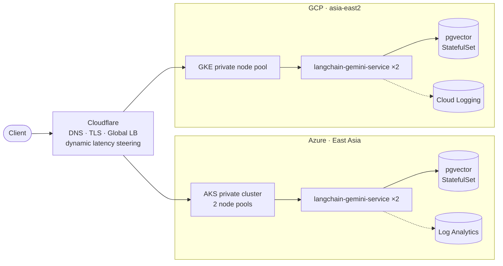

# Deploy and manage Multi Cloud Kubernetes with Terraform (ITP4121  assignment)
### Create multiple public cloud infrastructure and Kubernetes deployment with Terraform

## ✅ Assignment Requirements

| # | Requirement | Marks | Where |
|---|---|---|---|
| 1 | Multiple Cloud Providers | 15 | Azure AKS + GCP GKE |
| 2 | VPC + 2 Private Subnets | 5 | `terraform/azure/` — 2 subnets; GCP ⚠️ 1 subnet |
| 3 | Cluster AutoScaler | 5 | AKS 1–2 per pool, GKE 1–3 |
| 4 | App with PostgreSQL StatefulSet | 5 | `kubernetes/` — pgvector |
| 5 | Kubernetes Secrets | 5 | `pgvector-secrets`, `langchain-gemini-service-secrets` |
| 6 | Cloud-native Load Balancer | 5 | Ingress + Cloudflare GSLB ⚠️ Azure AGIC |
| 7 | SSL/TLS | 5 | Cloudflare edge TLS |
| 8 | Cloud Logging | 5 | Log Analytics + Cloud Logging |
| 9 | Multi-Cloud HA (DNS) | 5 | Cloudflare pools + TCP health checks |

> **My role:** architecture and implementation of the entire stack — Azure and GCP infrastructure,
> the Kubernetes platform, and the application deployment. Coursework, built and demoed end-to-end
> on both clouds, then torn down.

Two private Kubernetes clusters — one per cloud — run the same LangChain + Gemini service over a
`pgvector` PostgreSQL StatefulSet. Cloudflare health-checks both origins and steers traffic between
them. No node in either cluster has a public IP.

**Stack:** Terraform · Azure (AKS, VNet, NAT Gateway, Log Analytics) · GCP (GKE, Cloud NAT, Cloud
Logging) · Kubernetes 1.31 · Cloudflare DNS / GSLB / TLS · PostgreSQL + pgvector · LangChain ·
Gemini · Bash

## Architecture

Azure runs two node pools, one in each of two private subnets, spread across two availability zones;
GKE runs a single private node pool across two zones. Node pools autoscale (AKS 1–2 per pool, GKE
1–3) and egress through managed NAT. Azure's API server is private; GKE's control-plane endpoint is
public but restricted by authorised networks.

